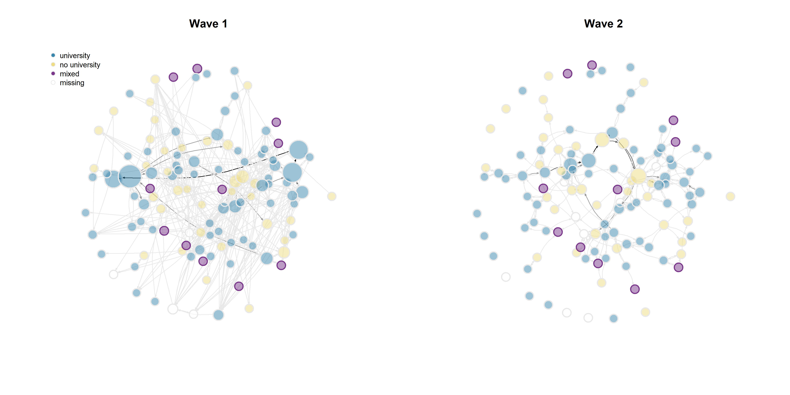

```{r setup, include=FALSE}
knitr::opts_chunk$set(echo = TRUE)
```

```{r klippy, echo=FALSE, include=TRUE}
klippy::klippy(position = c('top', 'right'))
#klippy::klippy(color = 'darkred')
#klippy::klippy(tooltip_message = 'Click to copy', tooltip_success = 'Done')
```

```{r}
rm(list = ls())

#function by Jochem

fpackage.check <- function(packages) {
    lapply(packages, FUN = function(x) {
        if (!require(x, character.only = TRUE)) {
            install.packages(x, dependencies = TRUE)
            library(x, character.only = TRUE)
        }
    })
}

fsave <- function(x, file = NULL, location = "./data/processed/") {
    ifelse(!dir.exists("data"), dir.create("data"), FALSE)
    ifelse(!dir.exists("data/processed"), dir.create("data/processed"), FALSE)
    if (is.null(file))
        file = deparse(substitute(x))
    datename <- substr(gsub("[:-]", "", Sys.time()), 1, 8)
    totalname <- paste(location, datename, file, ".rda", sep = "")
    save(x, file = totalname)  #need to fix if file is reloaded as input name, not as x. 
}

fload <- function(filename) {
    load(filename)
    get(ls()[ls() != "filename"])
}

fshowdf <- function(x, ...) {
    knitr::kable(x, digits = 2, "html", ...) %>%
        kableExtra::kable_styling(bootstrap_options = c("striped", "hover")) %>%
        kableExtra::scroll_box(width = "100%", height = "300px")
}

colorize <- function(x, color) {
    sprintf("<span style='color: %s;'>%s</span>", color, x)
}

packages <- c("sna","ape", "network", "devtools", "igraph", "RSiena", "tidyverse", "stringdist", "stringi")
lapply(packages, require, character.only=T)

```

```{r}
load("./data/EduBridgeforRSiena.RData")
```

# Descriptive Analysis

## Visualisation

```{r}
hangingt1nona <- hanging_df_t1
hangingt1nona[hangingt1nona==9]<- 0
hangingt1nona <- as.matrix(hangingt1nona)
hangingt1 <- graph_from_adjacency_matrix(hangingt1nona, mode = "directed", weighted = NULL, diag = TRUE, add.colnames = NA, add.rownames = NA)

hangingt2nona <- hanging_df_t2
hangingt2nona[hangingt2nona==9]<- 0
hangingt2nona <- as.matrix(hangingt2nona)
hangingt2 <- graph_from_adjacency_matrix(hangingt2nona, mode = "directed", weighted = NULL, diag = TRUE, add.colnames = NA, add.rownames = NA)

rangegray <- colorRampPalette(c("grey91", "grey50", "grey30", "black"))
nbins <- 5
colourbetweenness <-rangegray(nbins)
colourpareduhigh <- ifelse(is.na(parenteduhigh), "white", ifelse(parentedudif==1, "mediumorchid4", ifelse(parenteduhigh==1, "#3A87AD", "lightgoldenrod")))
colourparedudif <- ifelse(is.na(parentedudif), "grey91", ifelse(parentedudif==1, "mediumorchid4", "grey91"))

layoutfr2 <- layout.fruchterman.reingold(hangingt2)
layoutdh2 <- igraph:: layout_with_dh(hangingt2)

V(hangingt1)$size = igraph::degree(hangingt1) * 0.4 + 7
V(hangingt2)$size = igraph::degree(hangingt2) * 0.4 + 7

{png("plot2.png", width = 14, height = 7, units = "in", res = 300)

par(mfrow = c(1, 2))

plot(hangingt1,
     vertex.color = adjustcolor(colourpareduhigh, alpha.f = .5),
     vertex.frame.color = colourparedudif,
     vertex.frame.width = 2,
     vertex.label = NA,
     edge.curved = 0.2,
     edge.arrow.size = 0.2,
     edge.color = colourbetweenness[cut(igraph::edge_betweenness(hangingt1), breaks=nbins )],
     layout = layoutfr2, 
     main = "Wave 1")

legend("topleft", c("university", "no university", "mixed", "missing"), pch = 21, col = "grey91", pt.bg = c("#3A87AD", "lightgoldenrod", "mediumorchid4", "white"), pt.cex = 1,
    cex = 0.8, bty = "n", ncol = 1)

plot(hangingt2,
     vertex.color = adjustcolor(colourpareduhigh, alpha.f = .5),
     vertex.frame.color = colourparedudif,
     vertex.frame.width = 2,
     vertex.label = NA,
     edge.curved = 0.2,
     edge.arrow.size = 0.2,
     edge.color = colourbetweenness[cut(igraph::edge_betweenness(hangingt2), breaks=nbins )],
     layout = layoutfr2, 
     main = "Wave 2")
dev.off()}
```

```{r}
knitr::include_graphics("plot2.png")
```

*Note:* Nodes were distributed in the graph based on the Fruchterman-Reingold forcedirected algorithm, which models repulsion between nodes and attraction between nodes that are unconnected. The nodes were fixed in their w2 location for both waves to visualise changes in specific ties. Node size indicates degree, darkness of ties indicates betweenness.

Before investigating whether the hypothesised effects are significant in individual students' tie-making and -breaking, it is important to understand the observable dynamics within the network. For this purpose, I first explore the descriptive statistics in both waves. I start with descriptives related to the evolution of ties, density, and pathlength, then I discuss triad configurations within the network, before finally calculating segregation based on parental educational attainment to answer research question 1.

## Tie evolution

```{r}
dyad_census(hangingt1)
```

```{r}
dyad_census(hangingt2)
```

```{r}
edge_density(hangingt1)
```

```{r}
edge_density(hangingt2)
```

Between wave 1 and wave 2, we can observe a substantial reduction in the number of ties within students' hanging out network. While in the first wave, a total number of 302 pairs were connected, 93 of which were reciprocal connections, by the second wave, only 210 connections remain. This entails a drop of 30.5% of the initial number of dyads. This is reflected in density, which is low in both networks, but also drops substantially between waves (from 0.027 to 0.019). This is also observable in the above figure: many ties are broken between wave 1 and wave 2. The evolution of hanging out networks in this community of university students is thus strongly shaped by endowment, i.e. the decision to maintain or break a tie. Investigating homophily effects in endowment specifically is therefore particularly relevant for this context.

```{r}
degdis1 <- degree_distribution(hangingt1, cumulative = FALSE)
library(lattice)
barplot(degdis1, xlab = "Degree", ylab = "Share of Total (Decimal)", names.arg = 1:23, col = "mediumorchid4")
```

```{r}
degdis2 <- degree_distribution(hangingt2, cumulative = FALSE)
barplot(degdis2, xlab = "Degree", ylab = "Share of Total (Decimal)", names.arg = 1:20, col = "mediumorchid4")
```

```{r}
mean_distance(hangingt1, directed = T, unconnected = T, details = T)
```

```{r}
mean_distance(hangingt2, directed = T, unconnected = T, details = T)
```

Surprisingly, the average shortest path length between vectors, not counting isolates, decreases from 4.84 in the first wave to 4.59 in the second wave - despite the reduction in the total number of connected pairs. This may be explained by the presence of several efficient brokers between clusters, visible in the wave 2 network depiction.

```{r}
hangingt1m <- as.matrix(hanging_df_t1)
hangingt2m <- as.matrix(hanging_df_t2)
sna::triad.census(hangingt1m)
```

```{r}
sna::triad.census(hangingt2m)
```

Between both waves, we can observe a reduction in all triad types except for the 111U constellation, which raises from occurring 920 times to occurring 1050 times, and the 120C constellation, which remains constant. This observed reduction in most tryad compositions is likely another consequence of the overall reduction in ties.

## Segregation

To answer the first research question, I calculate Moran's I, a spatial autocorrelation measure used to indicate whether nodes that are closer to one another are more alike. Under the null hypothesis of no segregation, the expected value of I is -1/(N-1). An observed I larger than the expected indicates positive autocorrelation, an observed I smaller than the expected indicates negative autocorrelation (the opposite of segregation) [@disalvatore2021]. As I am interested in selection rather than influence, I use a distance decay function of 1, i.e. I test whether students who are directly connected are more similar in their parents' highest educational attainment. I do not rowstandardise, since rowstandardising would treat a student connected to only one peer with a different educational heritage and no others the same as it would a student connected to several such peers and no others.

```{r}
hangingt1m <- as.matrix(hanging_df_t1)
hangingt2m <- as.matrix(hanging_df_t2)

# step 1: calculate distances
geodistances <- geodist(hangingt1m, count.paths = TRUE)
geodistances <- geodistances$gdist
# set the distance to yourself as Inf
diag(geodistances) <- Inf


# step 2: define a distance decay function. This one is pretty standard in the spatial autocorrelation literature but actually pretty arbitrary.
weights1 <- geodistances == 1
weights2 <- exp(-geodistances)
```

```{r}
#Jochem's formula for Moran's I

fMoran.I <- function(x, weight, scaled = FALSE, na.rm = FALSE, alternative = "two.sided", rowstandardize = TRUE) {
    if (rowstandardize) {
        if (dim(weight)[1] != dim(weight)[2])
            stop("'weight' must be a square matrix")
        n <- length(x)
        if (dim(weight)[1] != n)
            stop("'weight' must have as many rows as observations in 'x'")
        ei <- -1/(n - 1)
        nas <- is.na(x)
        if (any(nas)) {
            if (na.rm) {
                x <- x[!nas]
                n <- length(x)
                weight <- weight[!nas, !nas]
            } else {
                warning("'x' has missing values: maybe you wanted to set na.rm = TRUE?")
                return(list(observed = NA, expected = ei, sd = NA, p.value = NA))
            }
        }
        ROWSUM <- rowSums(weight)
        ROWSUM[ROWSUM == 0] <- 1
        weight <- weight/ROWSUM
        s <- sum(weight)
        m <- mean(x)
        y <- x - m
        cv <- sum(weight * y %o% y)
        v <- sum(y^2)
        obs <- (n/s) * (cv/v)
        if (scaled) {
            i.max <- (n/s) * (sd(rowSums(weight) * y)/sqrt(v/(n - 1)))
            obs <- obs/i.max
        }
        S1 <- 0.5 * sum((weight + t(weight))^2)
        S2 <- sum((apply(weight, 1, sum) + apply(weight, 2, sum))^2)
        s.sq <- s^2
        k <- (sum(y^4)/n)/(v/n)^2
        sdi <- sqrt((n * ((n^2 - 3 * n + 3) * S1 - n * S2 + 3 * s.sq) - k * (n * (n - 1) * S1 - 2 * n *
            S2 + 6 * s.sq))/((n - 1) * (n - 2) * (n - 3) * s.sq) - 1/((n - 1)^2))
        alternative <- match.arg(alternative, c("two.sided", "less", "greater"))
        pv <- pnorm(obs, mean = ei, sd = sdi)
        if (alternative == "two.sided")
            pv <- if (obs <= ei)
                2 * pv else 2 * (1 - pv)
        if (alternative == "greater")
            pv <- 1 - pv
        list(observed = obs, expected = ei, sd = sdi, p.value = pv)
    } else {
        if (dim(weight)[1] != dim(weight)[2])
            stop("'weight' must be a square matrix")
        n <- length(x)
        if (dim(weight)[1] != n)
            stop("'weight' must have as many rows as observations in 'x'")
        ei <- -1/(n - 1)
        nas <- is.na(x)
        if (any(nas)) {
            if (na.rm) {
                x <- x[!nas]
                n <- length(x)
                weight <- weight[!nas, !nas]
            } else {
                warning("'x' has missing values: maybe you wanted to set na.rm = TRUE?")
                return(list(observed = NA, expected = ei, sd = NA, p.value = NA))
            }
        }
        # ROWSUM <- rowSums(weight) ROWSUM[ROWSUM == 0] <- 1 weight <- weight/ROWSUM
        s <- sum(weight)
        m <- mean(x)
        y <- x - m
        cv <- sum(weight * y %o% y)
        v <- sum(y^2)
        obs <- (n/s) * (cv/v)
        if (scaled) {
            i.max <- (n/s) * (sd(rowSums(weight) * y)/sqrt(v/(n - 1)))
            obs <- obs/i.max
        }
        S1 <- 0.5 * sum((weight + t(weight))^2)
        S2 <- sum((apply(weight, 1, sum) + apply(weight, 2, sum))^2)
        s.sq <- s^2
        k <- (sum(y^4)/n)/(v/n)^2
        sdi <- sqrt((n * ((n^2 - 3 * n + 3) * S1 - n * S2 + 3 * s.sq) - k * (n * (n - 1) * S1 - 2 * n *
            S2 + 6 * s.sq))/((n - 1) * (n - 2) * (n - 3) * s.sq) - 1/((n - 1)^2))
        alternative <- match.arg(alternative, c("two.sided", "less", "greater"))
        pv <- pnorm(obs, mean = ei, sd = sdi)
        if (alternative == "two.sided")
            pv <- if (obs <= ei)
                2 * pv else 2 * (1 - pv)
        if (alternative == "greater")
            pv <- 1 - pv
        list(observed = obs, expected = ei, sd = sdi, p.value = pv)
    }


}
```

```{r}
fMoran.I(parenteduhigh, scaled = FALSE, weight = weights1, na.rm = TRUE, rowstandardize = FALSE)
```

```{r}
# step 1: calculate distances
geodistances2 <- geodist(hangingt2m, count.paths = TRUE)
geodistances2 <- geodistances2$gdist
# set the distance to yourself as Inf
diag(geodistances2) <- Inf


# step 2: define a distance decay function. This one is pretty standard in the spatial autocorrelation literature but actually pretty arbitrary.
weights3 <- exp(-geodistances2)

fMoran.I(parenteduhigh, scaled = FALSE, weight = weights3, na.rm = TRUE, rowstandardize = FALSE)
```

There is no evidence for segregation based on parental educational levels in either wave, indicating that across the entire network, students that hang out together are not necessarily more similar regarding the highest educational attainment among their parent(s)/caregiver(s). However, it is possible for the overall segregation to be insignificant while segregation does occur within specific clusters, in this case friend groups [@disalvatore2021]. Additionally, other network effects such as meeting opportunities through mutual friends may account for the lack of observed segregation. To answer research question two and three, it is therefore necessary to model students' individual evaluation functions.

## Students with a Mixed Background

```{r}
V(hangingt1)$size = igraph::betweenness(hangingt1, normalized = T, directed = TRUE) * 70 + 7
V(hangingt2)$size = igraph::betweenness(hangingt2, normalized = T, directed = TRUE) * 70 + 7

{png("plot3.png", width = 14, height = 7, units = "in", res = 300)

par(mfrow = c(1, 2))

plot(hangingt1,
     vertex.color = adjustcolor(colourpareduhigh, alpha.f = .5),
     vertex.frame.color = colourparedudif,
     vertex.frame.width = 2,
     vertex.label = NA,
     edge.curved = 0.2,
     edge.arrow.size = 0.2,
     edge.color = colourbetweenness[cut(igraph::edge_betweenness(hangingt1), breaks=nbins )],
     layout = layoutfr2, 
     main = "Wave 1")

legend("topleft", c("university", "no university", "mixed", "missing"), pch = 21, col = "grey91", pt.bg = c("#3A87AD", "lightgoldenrod", "mediumorchid4", "white"), pt.cex = 1,
    cex = 0.8, bty = "n", ncol = 1)

plot(hangingt2,
     vertex.color = adjustcolor(colourpareduhigh, alpha.f = .5),
     vertex.frame.color = colourparedudif,
     vertex.frame.width = 2,
     vertex.label = NA,
     edge.curved = 0.2,
     edge.arrow.size = 0.2,
     edge.color = colourbetweenness[cut(igraph::edge_betweenness(hangingt2), breaks=nbins )],
     layout = layoutfr2, 
     main = "Wave 2")
dev.off()}
```

```{r}

```

# Explanatory Analysis

## Model input preparation

### Network in waves

```{r}
#wave 1 = hangingt1, wave 2 = hangingt2
hangingt1m <- as.matrix(hanging_df_t1)
hangingt2m <- as.matrix(hanging_df_t2)
#diagonals to zero
diag(hangingt1m) <- 0
diag(hangingt2m) <- 0
#missings to NA
hangingt1mwna <- hangingt1m
hangingt1mwna[hangingt1mwna == 9] <- 10
hangingt2mwna <- hangingt2m
hangingt2mwna[hangingt2mwna == 9] <- 10


#nets into array
hanging_array <- array(data = c(hangingt1mwna, hangingt2mwna), dim = c(dim(hangingt1mwna), 2))

#dependent
net <- sienaDependent(hanging_array)
```

### Covariates: parenteduhigh, parentedudif, ethnew, gendernew

```{r}
gendercov <- coCovar(gendernew) #constant covariate
ethcov <- coCovar(ethnew)
paredudifcov <- coCovar(parentedudif)
pareduhighcov <- coCovar(parenteduhigh)
mydata <- sienaDataCreate(net, gendercov, ethcov, paredudifcov, pareduhighcov)
```

### Overview of Siena data

```{r}
write_report(mydata, outputName = "sienaData")
```

```{r, child = "sienaData.txt", results = "asis"}
```

## Model 1: Homophily

```{r}
myeff0910 <- getEffects(mydata)
# effectsDocumentation(myeff0910)
```

```{r}
ifelse(!dir.exists("results"), dir.create("results"), FALSE)
print01Report(mydata, modelname = "./results/edu_bridge")
```

First some basic effects that are not really of theoretical interest:

```{r}
myeff <- includeEffects(myeff0910, outAct, inPop, inAct, recip, gwespFF)  
```

Now I'll introduce homophily as endow function:

```{r}
myeff <- includeEffects(myeff, sameX, egoX, altX, type = "endow", interaction1 = "pareduhighcov")
myeff
```

And as creation function:

```{r}
myeff <- includeEffects(myeff, sameX, egoX, altX, type = "creation", interaction1 = "pareduhighcov")
myeff
```

```{r}
myAlgorithm <- sienaAlgorithmCreate(projname = "edu_bridge",
                                    MaxDegree = c(net = 10),
                                    n3 = 2000,
                                    seed = 30000)
```
```{r, eval = FALSE}
mod1 <- siena07(myAlgorithm, data = mydata, effects = myeff, returnDeps = TRUE) 
```
```{r}
#mod1 <- saveRDS(mod1, "mod1.rds")
mod1 <- readRDS("mod1.rds")
```

The overall convergence ratio is under .25, which is acceptable. Convergence of individual parameters is also sufficient (absolute values all under 0.1). The rate parameter value is 8.58, indicating that each actor had, on average, 8.58 options for change ('mini-steps') within the simulation.

```{r}
results <- data.frame(
  effect = mod1$effects$effectName,
  b = mod1$theta,
  se = mod1$se,
  t = mod1$theta / mod1$se,
  p = 2 * pnorm(-abs(mod1$theta / mod1$se)))

pander::pander(results)
```

### Goodness of Fit

```{r}
#Jochem's formula for Geodesic Distribution

GeodesicDistribution <- function(i, data, sims, period, groupName, varName, levls = c(1:5, Inf), cumulative = TRUE,
    ...) {
    x <- networkExtraction(i, data, sims, period, groupName, varName)
    require(sna)
    a <- sna::geodist(symmetrize(x))$gdist
    if (cumulative) {
        gdi <- sapply(levls, function(i) {
            sum(a <= i)
        })
    } else {
        gdi <- sapply(levls, function(i) {
            sum(a == i)
        })
    }
    names(gdi) <- as.character(levls)
    gdi
}

# The following function is taken from the help page for sienaTest

testall <- function(ans) {
    for (i in which(ans$test)) {
        sct <- score.Test(ans, i)
        cat(ans$requestedEffects$effectName[i], "\n")
        print(sct)
    }
    invisible(score.Test(ans))
}
```

```{r}
gofinm1 <- sienaGOF(mod1, IndegreeDistribution, verbose = FALSE, join = TRUE, varName = "net", levls = 0:13)
plot(gofinm1)
```

```{r}
gofoutm1 <- sienaGOF(mod1, OutdegreeDistribution, verbose = FALSE, join = TRUE, varName = "net", levls = 0:10)
plot(gofoutm1)
```

```{r}
gofgdm1 <- sienaGOF(mod1, GeodesicDistribution, cumulative = FALSE, verbose = FALSE, join = TRUE, varName = "net")
plot(gofgdm1)
```

```{r}
goftrim1 <- sienaGOF(mod1, TriadCensus, verbose = FALSE, join = TRUE, varName = "net")
plot(goftrim1, center = TRUE, scale = TRUE)
```

The simulated networks based on the included effects show reasonable similarity with the observed network in terms of in-degree distribution, geodesic distribution, and triad census. However, the model seems to somewhat underestimate the number of nodes with out-degree 0, and overestimate the number of nodes with out-degree 1. A potential explanation for the higher observed number of nodes with out-degree 0 might be that isolated students are less likely to increase their out-degree. In the following sub-model, I thus include the outIso effect.

### (sub)Model 1.1: outIso

```{r}
myeff1.1 <- includeEffects(myeff, outIso)
myeff1.1
```

```{r, eval = FALSE}
mod1.1 <- siena07(myAlgorithm, data = mydata, effects = myeff1.1, prevAns = mod1, returnDeps = TRUE) 
```
```{r}
#mod1.1 <- saveRDS(mod1.1, "mod1.1.rds")
mod1.1 <- readRDS("mod1.1.rds")
```

```{r}
results2 <- data.frame(
  effect = mod1.1$effects$effectName,
  b = mod1.1$theta,
  se = mod1.1$se,
  t = mod1.1$theta / mod1.1$se,
  p = 2 * pnorm(-abs(mod1.1$theta / mod1.1$se)))

pander::pander(results2)
```

Although the overall maximum convergence ratio is acceptable, including the outIso effect destabilises the estimation of the individual effects, reflected in very high convergence t-ratio statistics. The ego-effects of highest parental educational attainment demonstrate particularly high standard errors, as well as suspiciously pronounced estimates. The lack of convergence makes this an inappropriate model to proceed with.

### (sub)Model 1.2: inIsDegree

```{r}
myeff1.2 <- includeEffects(myeff, inIsDegree)
myeff1.2
```

```{r}
#mod1.2 <- siena07(myAlgorithm, data = mydata, effects = myeff1.2, prevAns = mod1, returnDeps = TRUE) 
#mod1.2
```

Including inIsDegree greatly destabilises the model. Parameter estimates rise to unrealistically high values, with huge standard errors and individual convergence ratios way above 0.1. The maximum covergence ratio is absolutely unacceptable at 22.8.

### (sub)Model 1.3: removing inPop

In model 1, the in-degree popularity was not significant. As this effect is not of theoretical interest, and reducing complexity can aid convergence and fit, I will remove the effect from the model.

```{r}
myeff1.3 <- includeEffects(myeff0910, outAct, inAct, recip, gwespFF) 
myeff1.3
```

```{r}
myeff1.3 <- includeEffects(myeff1.3, sameX, egoX, altX, type = "endow", interaction1 = "pareduhighcov")
myeff1.3
```

```{r}
myeff1.3 <- includeEffects(myeff1.3, sameX, egoX, altX, type = "creation", interaction1 = "pareduhighcov")
myeff1.3
```

```{r, eval=FALSE}
mod1.3 <- siena07(myAlgorithm, data = mydata, effects = myeff1.3, returnDeps = TRUE) 
```
```{r}
#mod1.3 <- saveRDS(mod1.3, "mod1.3.rds")
mod1.3 <- readRDS("mod1.3.rds")
```


```{r}
results1.3 <- data.frame(
  effect = mod1.3$effects$effectName,
  b = mod1.3$theta,
  se = mod1.3$se,
  t = mod1.3$theta / mod1.3$se,
  p = 2 * pnorm(-abs(mod1.3$theta / mod1.3$se)))

pander::pander(results1.3)
```

No big changes in convergence can be observed compared to model 1. The in-degree popularity x out-degree activity interaction effect remains significant in the absence of one of its lower-order effects. Both the endowment and the creation homophily effects remain significant (p \< .001 and p = .014, respectively). The creation estimate is positive, indicating that students prefer forming ties with peers with the same highest parental educational attainment as themselves (e.g. first-generation students prefer ties with other first-generation students, students with a generational history of university attendance prefer ties with other students who have a generational history of university attendance). The sign for the endowment estimate is negative, indicating that homophily is weaker for the decision to maintain a tie than for creating new ties. Interestingly, the alter effect of highest parental educational attainment in endowment is also significant, with a positive parameter estimate. This indicates that students prefer maintaining ties with peers whose parents have university experience.

### Goodness of Fit

```{r}
gofinm1.3 <- sienaGOF(mod1.3, IndegreeDistribution, verbose = FALSE, join = TRUE, varName = "net", levls = 0:13)
plot(gofinm1.3)
```

```{r}
gofoutm1.3 <- sienaGOF(mod1.3, OutdegreeDistribution, verbose = FALSE, join = TRUE, varName = "net", levls = 0:10)
plot(gofoutm1.3)
```

```{r}
goftrim1.3 <- sienaGOF(mod1.3, TriadCensus, verbose = FALSE, join = TRUE, varName = "net")
plot(goftrim1.3, center = TRUE, scale = TRUE)
```

```{r}
gofgdm1.3 <- sienaGOF(mod1.3, GeodesicDistribution, cumulative = FALSE, verbose = FALSE, join = TRUE, varName = "net")
plot(gofgdm1.3)
```

Removing the in-degree popularity effect improved the outdegree distribution fit, bringing the p-value up to 0.038 - which is still significant, but certainly closer to the arbitrary 0.05 threshold.

### (sub)Model 1.4: removing alter effect

In the previous sub-models, the creation effect of alters' highest parental educational attainment and the endowment effect of ego's highest parental educational attainment were insignificant and had large standard errors. This might contribute to the observed lack of convergence when adding additional network statistics, even though these statistics improve goodness of fit. In the following sub-model, I will therefore rerun the model, but without the creation effect for alters' highest parental educational attainment. I start with removing the alter highest parental educational attainment creation effect as this effect demonstrated the highest p-value in model 1 and 1.3. Generally, it is preferable to include all lower level components of an interaction, as it is usually not reasonable to assume that their main effect will be 0 when accounting for the interaction. However, as the effect has consistently been insignificant, the assumption is acceptable in the current situation.

```{r}
myeff1.4 <- includeEffects(myeff0910, outAct, inAct, recip, gwespFF)  
```

```{r}
myeff1.4 <- includeEffects(myeff1.4, sameX, egoX, altX, type = "endow", interaction1 = "pareduhighcov")
myeff1.4
```

```{r}
myeff1.4 <- includeEffects(myeff1.4, sameX, egoX, type = "creation", interaction1 = "pareduhighcov")
myeff1.4
```

```{r, eval = FALSE}
mod1.4 <- siena07(myAlgorithm, data = mydata, effects = myeff1.4, returnDeps = TRUE) 
```
```{r}
#mod1.4 <- saveRDS(mod1.4, "mod1.4.rds")
mod1.4 <- readRDS("mod1.4.rds")
```

```{r}
results1.4 <- data.frame(
  effect = mod1.4$effects$effectName,
  b = mod1.4$theta,
  se = mod1.4$se,
  t = mod1.4$theta / mod1.4$se,
  p = 2 * pnorm(-abs(mod1.4$theta / mod1.4$se)))

pander::pander(results1.4)
```

### Goodness of Fit

```{r}
gofinm1.4 <- sienaGOF(mod1.4, IndegreeDistribution, verbose = FALSE, join = TRUE, varName = "net", levls = 0:13)
plot(gofinm1.4)
```

```{r}
gofoutm1.4 <- sienaGOF(mod1.4, OutdegreeDistribution, verbose = FALSE, join = TRUE, varName = "net", levls = 0:10)
plot(gofoutm1.4)
```

```{r}
goftrim1.4 <- sienaGOF(mod1.4, TriadCensus, verbose = FALSE, join = TRUE, varName = "net")
plot(goftrim1.4, center = TRUE, scale = TRUE)
```

```{r}
gofgdm1.4 <- sienaGOF(mod1.4, GeodesicDistribution, cumulative = FALSE, verbose = FALSE, join = TRUE, varName = "net")
plot(gofgdm1.4)
```

Interestingly, removing the alter effect results in the in-degree activity/out-degree popularity interaction effect turning insignificant. Removing the alter effect does not however strongly improve fit and slightly increases the maximum convergence ratio. Given the general preference for retaining lower-order effects of interactions, I will therefore proceed with the previous model (1.3).

### (sub)Model 1.5: No inPop, with outIso

```{r}
myeff1.5 <- includeEffects(myeff1.3, outIso) 
myeff1.5
```

```{r, eval = FALSE}
mod1.5 <- siena07(myAlgorithm, data = mydata, effects = myeff1.5, prevAns = mod1.3, returnDeps = TRUE) 
```
```{r}
#mod1.5 <- saveRDS(mod1.5, "mod1.5.rds")
mod1.5 <- readRDS("mod1.5.rds")
```

```{r}
results1.5 <- data.frame(
  effect = mod1.5$effects$effectName,
  b = mod1.5$theta,
  se = mod1.5$se,
  t = mod1.5$theta / mod1.5$se,
  p = 2 * pnorm(-abs(mod1.5$theta / mod1.5$se)))

pander::pander(results1.5)
```

### Goodness of Fit

```{r}
gofinm1.5 <- sienaGOF(mod1.5, IndegreeDistribution, verbose = FALSE, join = TRUE, varName = "net", levls = 0:13)
plot(gofinm1.5)
```

```{r}
gofoutm1.5 <- sienaGOF(mod1.5, OutdegreeDistribution, verbose = FALSE, join = TRUE, varName = "net", levls = 0:10)
plot(gofoutm1.5)
```

```{r}
goftrim1.5 <- sienaGOF(mod1.5, TriadCensus, verbose = FALSE, join = TRUE, varName = "net")
plot(goftrim1.5, center = TRUE, scale = TRUE)
```

```{r}
gofgdm1.5 <- sienaGOF(mod1.5, GeodesicDistribution, cumulative = FALSE, verbose = FALSE, join = TRUE, varName = "net")
plot(gofgdm1.5)
```

Adding an out-degree isolate effect did not improve the overall fit of the out-degree distribution, because the model now overestimates the number of nodes with one tie and understimates those with three ties.

## Model 2: Homophily x Educationally Mixed Family

```{r}
myeff2 <- includeEffects(myeff1.3, egoX, interaction1 = "paredudifcov", type = "endow")
myeff2
```

```{r}
myeff2 <- includeEffects(myeff2, egoX, interaction1 = "paredudifcov", type = "creation")
myeff2
```

```{r}
myeff2 <-  set_interaction(myeff2, list(sameX, egoX), type = "endow", covar1=c("pareduhighcov", "paredudifcov"))
myeff2
```

```{r}
myeff2 <-  set_interaction(myeff2, list(sameX, egoX), type = "creation", covar1=c("pareduhighcov", "paredudifcov"))
myeff2
```

```{r}
#mod2 <- siena07(myAlgorithm, data = mydata, effects = myeff2, prevAns = mod1.3, returnDeps = TRUE) 
#mod2
```

At 7.72, the overall maximum convergence ratio is unacceptable, and the estimated parameters unrealistic with very high standard errors. This points to the model being overly complex, which is not entirely unexpected based on the large number of both endowment and creation effects. I will proceed by combining all lower-level endowment and creation effects into evaluation effects (which should be equivalent to the combination of endowment and creation). The homophily and homophily x mixed effects will be kept as separate endowment and creation effects, as these are relevant to the research question.

### (sub)Model 2.1: reduced complexity

```{r}
myeff2.1 <- includeEffects(myeff0910, outAct, inAct, recip, gwespFF)  
```

```{r}
myeff2.1 <- includeEffects(myeff2.1, egoX, altX, type = "eval", interaction1 = "pareduhighcov")
myeff2.1
```

```{r}
myeff2.1 <- includeEffects(myeff2.1, egoX, interaction1 = "paredudifcov", type = "eval")
myeff2.1
```

```{r}
myeff2.1 <- includeEffects(myeff2.1, sameX, interaction1 = "pareduhighcov", type = "endow")
myeff2.1
```

```{r}
myeff2.1 <- includeEffects(myeff2.1, sameX, interaction1 = "pareduhighcov", type = "creation")
myeff2.1
```

```{r}
myeff2.1 <-  set_interaction(myeff2.1, list(sameX, egoX), type = "endow", covar1=c("pareduhighcov", "paredudifcov"))
myeff2.1
```

```{r}
myeff2.1 <-  set_interaction(myeff2.1, list(sameX, egoX), type = "creation", covar1=c("pareduhighcov", "paredudifcov"))
myeff2.1
```

```{r, eval = FALSE}
mod2.1 <- siena07(myAlgorithm, data = mydata, effects = myeff2.1, returnDeps = TRUE) 
```
```{r}
#mod2.1 <- saveRDS(mod2.1, "mod2.1.rds")
mod2.1 <- readRDS("mod2.1.rds")
```
```{r}
results2.1 <- data.frame(
  effect = mod2.1$requestedEffects$effectName,
  b = mod2.1$theta,
  se = mod2.1$se,
  t = mod2.1$theta / mod2.1$se,
  p = 2 * pnorm(-abs(mod2.1$theta / mod2.1$se)))

pander::pander(results2.1)
```

*Note:* The model automatically includes the internal effect parameters used for the interaction (in this case: the endowment and creation effect of ego having parents with different educational backgrounds), but these are not tested as part of the main model. I therefore do not report them in the above table.

The model shows acceptable convergence, overall maximum convergence rate \< 0.25, absolute convergence t-ratios \< 0.1. Although the signs of the estimates are in line with expectations, the interaction between homophily and ego having a mixed background is clearly insignificant for both endowment and creation (p = 0.846 and p = 3.99, respectively). The hypothesis that students whose parents have different educational attainments (university experience & no university experience) have lower levels of homophily is thus not supported. Homophily itself remains significant for creation. Homophily in endowment approaches significance based on a two-sided test, but given the one-sided nature of the hypothesis, it can be concluded that the results show support for the existence of preferences for homophily in endowment, too.

### Goodness of Fit

```{r}
gofinm2.1 <- sienaGOF(mod2.1, IndegreeDistribution, verbose = FALSE, join = TRUE, varName = "net", levls = 0:13)
plot(gofinm2.1)
```

```{r}
gofoutm2.1 <- sienaGOF(mod2.1, OutdegreeDistribution, verbose = FALSE, join = TRUE, varName = "net", levls = 0:10)
plot(gofoutm2.1)
```

```{r}
goftrim2.1 <- sienaGOF(mod2.1, TriadCensus, verbose = FALSE, join = TRUE, varName = "net")
plot(goftrim2.1, center = TRUE, scale = TRUE)
```

## Model 3: Control Variables

```{r}
myeff3 <- includeEffects(myeff2.1, egoX, altX, sameX, interaction1 = "gendercov")
myeff3
```

```{r}
myeff3 <- includeEffects(myeff3, egoX, altX, sameX, interaction1 = "ethcov")
myeff3
```

```{r, eval = FALSE}
mod3 <- siena07(myAlgorithm, data = mydata, effects = myeff3, prevAns = mod2.1, returnDeps = TRUE) 
```
```{r}
#mod3 <- saveRDS(mod3, "mod3.rds")
mod3 <- readRDS("mod3.rds")
```
```{r}
results3 <- data.frame(
  effect = mod3$requestedEffects$effectName,
  b = mod3$theta,
  se = mod3$se,
  t = mod3$theta / mod3$se,
  p = 2 * pnorm(-abs(mod3$theta / mod3$se)))

pander::pander(results3)
```

### Goodness of Fit

```{r}
gofinm3 <- sienaGOF(mod3, IndegreeDistribution, verbose = FALSE, join = TRUE, varName = "net", levls = 0:13)
plot(gofinm3)
```

```{r}
gofoutm3 <- sienaGOF(mod3, OutdegreeDistribution, verbose = FALSE, join = TRUE, varName = "net", levls = 0:10)
plot(gofoutm3)
```

```{r}
goftrim3 <- sienaGOF(mod3, TriadCensus, verbose = FALSE, join = TRUE, varName = "net")
plot(goftrim3, center = TRUE, scale = TRUE)
```

### (sub)Model 3.1: Isolates

Including outIso, outInAss, antiInIso, outOutAss, balance interferes with the convergence.

```{r}
myeff3.1 <- includeEffects(myeff3, balance)
myeff3.1
```

```{r}
#mod3.1 <- siena07(myAlgorithm, data = mydata, effects = myeff3.1, prevAns = mod3, returnDeps = TRUE) 
#mod3.1
```

# Model Summary


summary <- data.frame(
  Hypotheses = c("Hypothesis 1", "", "", "", "", "", "Hypothesis 2", "", "", "Controls"),
  "Model Name" = c("1", "1.1", "1.2", "1.3", "1.4", "1.5", "2", "2.1", "2.2", "3"),
  Converged = c("Yes", "No", "No", "Yes", "Yes", "Yes", "No", "Yes", "No", "Yes"),
  "GOF Indegree" = c(gofinm1$p, "", "", gofinm1.3$p, gofinm1.4$p, gofinm1.5$p, "", gofinm2.1$p, "", gofinm3$p),
  "GOF Outdegree" = c(gofoutm1$p, "", "", gofoutm1.3$p, gofoutm1.4$p, gofoutm1.5$p, "", gofoutm2.1$p, "", gofoutm3$p),
  "GOF Geodesic" = c(gofgdm1$p, "", "", gofgdm1.3$p, gofgdm1.4$p, gofgdm1.5$p, "", gofgdm2.1$p, "", gofgdm3$p),
  "GOF Triads" = c(goftrim1$p, "", "", goftrim1.3$p, goftrim1.4$p, goftrim1.5$p, "", goftrim2.1$p, "", goftrim3$p)
  )

pander::pander(summary)


# Relative Influence

```{r}
# get parameters
theta.eval <- mod1.3$theta
# and effects
myeff.eval <- mod1.3$effects

# use sienaRI() --> doesn't exist. Maybe interpret_size?
#RI <- interpret_size(mod1.3, data = mydata, theta = theta.eval, effects = myeff.eval)
#plot it
#plot(RI, addPieChart = TRUE) #I can't see the full legend...
```
