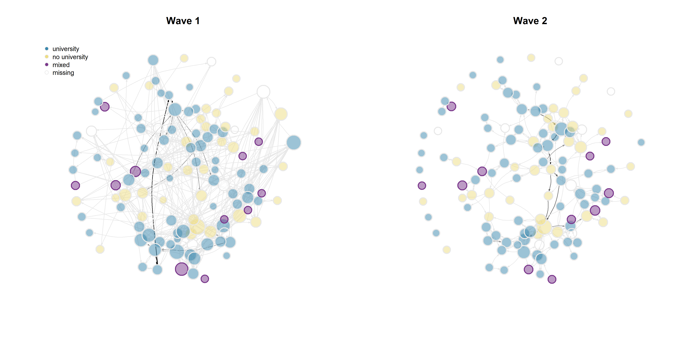

```{r setup, include=FALSE}
knitr::opts_chunk$set(echo = TRUE)
```

```{r klippy, echo=FALSE, include=TRUE}
klippy::klippy(position = c('top', 'right'))
#klippy::klippy(color = 'darkred')
#klippy::klippy(tooltip_message = 'Click to copy', tooltip_success = 'Done')
```
Cleaning environment + checking packages

```{r}
rm(list = ls())

#function by Jochem

fpackage.check <- function(packages) {
    lapply(packages, FUN = function(x) {
        if (!require(x, character.only = TRUE)) {
            install.packages(x, dependencies = TRUE)
            library(x, character.only = TRUE)
        }
    })
}

fsave <- function(x, file = NULL, location = "./data/processed/") {
    ifelse(!dir.exists("data"), dir.create("data"), FALSE)
    ifelse(!dir.exists("data/processed"), dir.create("data/processed"), FALSE)
    if (is.null(file))
        file = deparse(substitute(x))
    datename <- substr(gsub("[:-]", "", Sys.time()), 1, 8)
    totalname <- paste(location, datename, file, ".rda", sep = "")
    save(x, file = totalname)  #need to fix if file is reloaded as input name, not as x. 
}

fload <- function(filename) {
    load(filename)
    get(ls()[ls() != "filename"])
}

fshowdf <- function(x, ...) {
    knitr::kable(x, digits = 2, "html", ...) %>%
        kableExtra::kable_styling(bootstrap_options = c("striped", "hover")) %>%
        kableExtra::scroll_box(width = "100%", height = "300px")
}

colorize <- function(x, color) {
    sprintf("<span style='color: %s;'>%s</span>", color, x)
}

packages <- c("sna","ape", "network", "devtools", "igraph", "RSiena", "tidyverse", "stringdist", "stringi")
lapply(packages, require, character.only=T)

```
```{r}
load("./data/EduBridgeforRSiena.RData")
```

# Descriptive Analysis

## Visualisation

```{r}
hangingt1nona <- hanging_df_t1
hangingt1nona[hangingt1nona==9]<- 0
hangingt1nona <- as.matrix(hangingt1nona)


hangingt1 <- graph_from_adjacency_matrix(hangingt1nona, mode = "directed", weighted = NULL, diag = TRUE, add.colnames = NA, add.rownames = NA)

rangegray <- colorRampPalette(c("grey91", "grey50", "grey30", "black"))
nbins <- 5
colourbetweenness <-rangegray(nbins)
colourpareduhigh <- ifelse(is.na(parenteduhigh), "white", ifelse(parentedudif==1, "mediumorchid4", ifelse(parenteduhigh==1, "#3A87AD", "lightgoldenrod")))
colourparedudif <- ifelse(is.na(parentedudif), "grey91", ifelse(parentedudif==1, "mediumorchid4", "grey91"))

V(hangingt1)$size = igraph::betweenness(hangingt1, normalized = T, directed = TRUE)*50 + 7

plot(hangingt1,
     vertex.color = adjustcolor(colourpareduhigh, alpha.f = .5),
     vertex.frame.color = colourparedudif,
     vertex.frame.width = 2,
     vertex.label = NA,
     edge.curved = 0.2,
     edge.arrow.size = 0.2,
     edge.color = colourbetweenness[cut(igraph::edge_betweenness(hangingt1), breaks=nbins )],
     layout = layout.fruchterman.reingold, 
     main = "Wave 1")
```
```{r}
hangingt2nona <- hanging_df_t2
hangingt2nona[hangingt2nona==9]<- 0
hangingt2nona <- as.matrix(hangingt2nona)


hangingt2 <- graph_from_adjacency_matrix(hangingt2nona, mode = "directed", weighted = NULL, diag = TRUE, add.colnames = NA, add.rownames = NA)

layoutfr2 <- layout.fruchterman.reingold(hangingt2)

V(hangingt1)$size = igraph::degree(hangingt1)*0.35 + 7
V(hangingt2)$size = igraph::degree(hangingt2)*0.35 + 7

{png("plot2.png", width = 14, height = 7, units = "in", res = 300)

par(mfrow = c(1, 2))

plot(hangingt1,
     vertex.color = adjustcolor(colourpareduhigh, alpha.f = .5),
     vertex.frame.color = colourparedudif,
     vertex.frame.width = 2,
     vertex.label = NA,
     edge.curved = 0.2,
     edge.arrow.size = 0.2,
     edge.color = colourbetweenness[cut(igraph::edge_betweenness(hangingt1), breaks=nbins )],
     layout = layoutfr2, 
     main = "Wave 1")

legend("topleft", c("university", "no university", "mixed", "missing"), pch = 21, col = "grey91", pt.bg = c("#3A87AD", "lightgoldenrod", "mediumorchid4", "white"), pt.cex = 1,
    cex = 0.8, bty = "n", ncol = 1)

plot(hangingt2,
     vertex.color = adjustcolor(colourpareduhigh, alpha.f = .5),
     vertex.frame.color = colourparedudif,
     vertex.frame.width = 2,
     vertex.label = NA,
     edge.curved = 0.2,
     edge.arrow.size = 0.2,
     edge.color = colourbetweenness[cut(igraph::edge_betweenness(hangingt2), breaks=nbins )],
     layout = layoutfr2, 
     main = "Wave 2")
dev.off()}
```
```{r}

```
## Tie evolution
```{r}
dyad_census(hangingt1)
```
```{r}
dyad_census(hangingt2)
```
Between t1 and t2, we can observe a substantial reduction in the number of ties within students' hanging out network. Whereas at t1 a total number of 302 pairs were connected, 93 of which were reciprocal connections, at t2, only 210 connections remain. This entails a drop of 30.5% of the initial number of dyads. The evolution of hanging out networks in this community of university students is thus strongly shaped by endowment, i.e. the decision to maintain or break a tie.

```{r}
edge_density(hangingt1)
```
```{r}
edge_density(hangingt2)
```
```{r}
degree_distribution(hangingt1, cumulative = FALSE)
```
```{r}
degree_distribution(hangingt2, cumulative = FALSE)
```


## Average Shortest Path Length

```{r}
mean_distance(hangingt1, directed = T, unconnected = T, details = T)
```
```{r}
mean_distance(hangingt2, directed = T, unconnected = T, details = T)
```

The average shortest path length between vectors is 4.84 at t1, and, surprisingly, decreases to 4.59 at t2 - despite the reduction in the total number of connected pairs.

## Triad Census

```{r}
hangingt1m <- as.matrix(hanging_df_t1)
hangingt2m <- as.matrix(hanging_df_t2)
sna::triad.census(hangingt1m)
```
```{r}
sna::triad.census(hangingt2m)
```
Between t1 and t2, we can observe a reduction in all triad types except for the 111U constellation, which raises from occurring 920 times to occurring 1050 times, and the 120C constellation, which remains constant.

## Segregation

```{r}
hangingt1m <- as.matrix(hanging_df_t1)
hangingt2m <- as.matrix(hanging_df_t2)

# step 1: calculate distances
geodistances <- geodist(hangingt1m, count.paths = TRUE)
geodistances <- geodistances$gdist
# set the distance to yourself as Inf
diag(geodistances) <- Inf


# step 2: define a distance decay function. This one is pretty standard in the spatial autocorrelation literature but actually pretty arbitrary.
weights2 <- exp(-geodistances)
```

```{r}
#Jochem's formula for Moran's I

fMoran.I <- function(x, weight, scaled = FALSE, na.rm = FALSE, alternative = "two.sided", rowstandardize = TRUE) {
    if (rowstandardize) {
        if (dim(weight)[1] != dim(weight)[2])
            stop("'weight' must be a square matrix")
        n <- length(x)
        if (dim(weight)[1] != n)
            stop("'weight' must have as many rows as observations in 'x'")
        ei <- -1/(n - 1)
        nas <- is.na(x)
        if (any(nas)) {
            if (na.rm) {
                x <- x[!nas]
                n <- length(x)
                weight <- weight[!nas, !nas]
            } else {
                warning("'x' has missing values: maybe you wanted to set na.rm = TRUE?")
                return(list(observed = NA, expected = ei, sd = NA, p.value = NA))
            }
        }
        ROWSUM <- rowSums(weight)
        ROWSUM[ROWSUM == 0] <- 1
        weight <- weight/ROWSUM
        s <- sum(weight)
        m <- mean(x)
        y <- x - m
        cv <- sum(weight * y %o% y)
        v <- sum(y^2)
        obs <- (n/s) * (cv/v)
        if (scaled) {
            i.max <- (n/s) * (sd(rowSums(weight) * y)/sqrt(v/(n - 1)))
            obs <- obs/i.max
        }
        S1 <- 0.5 * sum((weight + t(weight))^2)
        S2 <- sum((apply(weight, 1, sum) + apply(weight, 2, sum))^2)
        s.sq <- s^2
        k <- (sum(y^4)/n)/(v/n)^2
        sdi <- sqrt((n * ((n^2 - 3 * n + 3) * S1 - n * S2 + 3 * s.sq) - k * (n * (n - 1) * S1 - 2 * n *
            S2 + 6 * s.sq))/((n - 1) * (n - 2) * (n - 3) * s.sq) - 1/((n - 1)^2))
        alternative <- match.arg(alternative, c("two.sided", "less", "greater"))
        pv <- pnorm(obs, mean = ei, sd = sdi)
        if (alternative == "two.sided")
            pv <- if (obs <= ei)
                2 * pv else 2 * (1 - pv)
        if (alternative == "greater")
            pv <- 1 - pv
        list(observed = obs, expected = ei, sd = sdi, p.value = pv)
    } else {
        if (dim(weight)[1] != dim(weight)[2])
            stop("'weight' must be a square matrix")
        n <- length(x)
        if (dim(weight)[1] != n)
            stop("'weight' must have as many rows as observations in 'x'")
        ei <- -1/(n - 1)
        nas <- is.na(x)
        if (any(nas)) {
            if (na.rm) {
                x <- x[!nas]
                n <- length(x)
                weight <- weight[!nas, !nas]
            } else {
                warning("'x' has missing values: maybe you wanted to set na.rm = TRUE?")
                return(list(observed = NA, expected = ei, sd = NA, p.value = NA))
            }
        }
        # ROWSUM <- rowSums(weight) ROWSUM[ROWSUM == 0] <- 1 weight <- weight/ROWSUM
        s <- sum(weight)
        m <- mean(x)
        y <- x - m
        cv <- sum(weight * y %o% y)
        v <- sum(y^2)
        obs <- (n/s) * (cv/v)
        if (scaled) {
            i.max <- (n/s) * (sd(rowSums(weight) * y)/sqrt(v/(n - 1)))
            obs <- obs/i.max
        }
        S1 <- 0.5 * sum((weight + t(weight))^2)
        S2 <- sum((apply(weight, 1, sum) + apply(weight, 2, sum))^2)
        s.sq <- s^2
        k <- (sum(y^4)/n)/(v/n)^2
        sdi <- sqrt((n * ((n^2 - 3 * n + 3) * S1 - n * S2 + 3 * s.sq) - k * (n * (n - 1) * S1 - 2 * n *
            S2 + 6 * s.sq))/((n - 1) * (n - 2) * (n - 3) * s.sq) - 1/((n - 1)^2))
        alternative <- match.arg(alternative, c("two.sided", "less", "greater"))
        pv <- pnorm(obs, mean = ei, sd = sdi)
        if (alternative == "two.sided")
            pv <- if (obs <= ei)
                2 * pv else 2 * (1 - pv)
        if (alternative == "greater")
            pv <- 1 - pv
        list(observed = obs, expected = ei, sd = sdi, p.value = pv)
    }


}
```

```{r}
fMoran.I(parenteduhigh, scaled = FALSE, weight = weights2, na.rm = TRUE, rowstandardize = FALSE)
```
We find no evidence for segregation based on parental educational attainment in hanging out networks of the first wave.
```{r}
# step 1: calculate distances
geodistances2 <- geodist(hangingt2m, count.paths = TRUE)
geodistances2 <- geodistances2$gdist
# set the distance to yourself as Inf
diag(geodistances2) <- Inf


# step 2: define a distance decay function. This one is pretty standard in the spatial autocorrelation literature but actually pretty arbitrary.
weights3 <- exp(-geodistances2)

fMoran.I(parenteduhigh, scaled = FALSE, weight = weights3, na.rm = TRUE, rowstandardize = FALSE)
```
We also find no evidence for segregation based on parental educational levels in the second wave.


# Explanatory Analysis

## Model input preparation

Get Network, Separate waves

```{r}
#wave 1 = hangingt1, wave 2 = hangingt2
hangingt1m <- as.matrix(hanging_df_t1)
hangingt2m <- as.matrix(hanging_df_t2)
#diagonals to zero
diag(hangingt1m) <- 0
diag(hangingt2m) <- 0
#missings to NA
hangingt1mwna <- hangingt1m
hangingt1mwna[hangingt1mwna == 9] <- 10
hangingt2mwna <- hangingt2m
hangingt2mwna[hangingt2mwna == 9] <- 10


#nets into array
hanging_array <- array(data = c(hangingt1mwna, hangingt2mwna), dim = c(dim(hangingt1mwna), 2))

#dependent
net <- sienaDependent(hanging_array)
```

Covariates: parenteduhigh, parentedudif, ethnew, gendernew

```{r}
gendercov <- coCovar(gendernew) #constant covariate
ethcov <- coCovar(ethnew)
paredudifcov <- coCovar(parentedudif)
pareduhighcov <- coCovar(parenteduhigh)
mydata <- sienaDataCreate(net, gendercov, ethcov, paredudifcov, pareduhighcov)
```

Effects

```{r}
myeff0910 <- getEffects(mydata)
# effectsDocumentation(myeff0910)
```
```{r}
ifelse(!dir.exists("results"), dir.create("results"), FALSE)
print01Report(mydata, modelname = "./results/edu_bridge")
```
First some basic effects that are not really of theoretical interest:
```{r}
myeff <- includeEffects(myeff0910, outAct, inPop, inAct, recip, GWESPFF)  
```
Now I'll introduce homophily:
```{r}
myeff <- includeEffects(myeff, sameX, egoX, altX, interaction1 = "pareduhighcov")
myeff
```
##Model 1: Homophily
```{r}
myAlgorithm <- sienaAlgorithmCreate(projname = "edu_bridge",
                                    MaxDegree = c(net = 10),
                                    seed = 30000)
mod1 <- siena07(myAlgorithm, data = mydata, effects = myeff) 
mod1
```
The overall convergence ratio is under .25, which is acceptable. Convergence of individual parameters is also sufficient. The rate parameter value is 7.34, indicating that each actor had, on average, 5.99 options for change ('mini-steps') within the simulation.
```{r}
test_parameter(mod1, tested=8) #Wald-type significance test
```
The estimate for homophily based on average parental educational attainment is positive, but low. The Wald-type significance test indicates that the effect of similarity in average parental educational attainment is insignificant, p = .798. 
##Model 2: Homophily x Educationally Mixed Family
```{r}
myeff2 <- includeEffects(myeff, egoX, interaction1 = "paredudifcov")
myeff2
```
```{r}
myeff2 <-  set_interaction(myeff2, list(sameX, egoX), covar1=c("pareduhighcov", "paredudifcov"))
myeff2
```


```{r}
mod2 <- siena07(myAlgorithm, data = mydata, effects = myeff2, prevAns = mod1, returnDeps = TRUE) 
mod2
```
The overall maximum convergence ratio is once again acceptable. The interaction effect of the difference between ego's parents' educational attainment with homophily is negative.
```{r}
test_parameter(mod2, tested=8)
```

### Goodness of Fit
```{r}
#Jochem's formula for Geodesic Distribution

GeodesicDistribution <- function(i, data, sims, period, groupName, varName, levls = c(1:5, Inf), cumulative = TRUE,
    ...) {
    x <- networkExtraction(i, data, sims, period, groupName, varName)
    require(sna)
    a <- sna::geodist(symmetrize(x))$gdist
    if (cumulative) {
        gdi <- sapply(levls, function(i) {
            sum(a <= i)
        })
    } else {
        gdi <- sapply(levls, function(i) {
            sum(a == i)
        })
    }
    names(gdi) <- as.character(levls)
    gdi
}

# The following function is taken from the help page for sienaTest

testall <- function(ans) {
    for (i in which(ans$test)) {
        sct <- score.Test(ans, i)
        cat(ans$requestedEffects$effectName[i], "\n")
        print(sct)
    }
    invisible(score.Test(ans))
}
```

```{r}
gof12.10.1 <- sienaGOF(mod2, IndegreeDistribution, verbose = FALSE, join = TRUE, varName = "net")
plot(gof12.10.1)
```
```{r}
gof12.10.2 <- sienaGOF(mod2, OutdegreeDistribution, verbose = FALSE, join = TRUE, varName = "net")
plot(gof12.10.2)
```
```{r}
gof12.10.3 <- sienaGOF(mod2, TriadCensus, verbose = FALSE, join = TRUE, varName = "net")
plot(gof12.10.3)
```
```{r}
gofgdm2 <- sienaGOF(mod2, GeodesicDistribution, cumulative = FALSE, verbose = FALSE, join = TRUE, varName = "net")
plot(gofgdm2)
```

### (sub)Model 3: inIsDegree
```{r}
myeff3 <- includeEffects(myeff2, inIsDegree)
myeff3
```
```{r}
mod3 <- siena07(myAlgorithm, data = mydata, effects = myeff3, prevAns = mod2, returnDeps = TRUE) 
mod3
```
### Goodness of Fit
```{r}
gof12.10.4 <- sienaGOF(mod3, IndegreeDistribution, verbose = FALSE, join = TRUE, varName = "net")
plot(gof12.10.4)
```
```{r}
gof12.10.5 <- sienaGOF(mod3, OutdegreeDistribution, verbose = FALSE, join = TRUE, varName = "net")
plot(gof12.10.5)
```
This did not change anything. I will kick inIsDegree out and replace it with a different isolate effect.

### (sub)Model 4: isolateNet
```{r}
myeff3.2 <- includeEffects(myeff2, isolateNet)
myeff3.2
```
```{r}
#mod4 <- siena07(myAlgorithm, data = mydata, effects = myeff3.2, prevAns = mod2, returnDeps = TRUE) 
#mod4
```
Convergence of 18 is very much unacceptable.

### (sub)Model 5: outIso

```{r}
myeff3.3 <- includeEffects(myeff2, outIso)
myeff3.3
```
```{r}
mod5 <- siena07(myAlgorithm, data = mydata, effects = myeff3.3, prevAns = mod2, returnDeps = TRUE) 
mod5
```
###Goodness of Fit

```{r}
gofinm5 <- sienaGOF(mod5, IndegreeDistribution, verbose = FALSE, join = TRUE, varName = "net")
plot(gofinm5)
```


```{r}
gofoutm5 <- sienaGOF(mod5, OutdegreeDistribution, verbose = FALSE, join = TRUE, varName = "net")
plot(gofoutm5)
```
```{r}
goftrim5 <- sienaGOF(mod5, TriadCensus, verbose = FALSE, join = TRUE, varName = "net")
plot(goftrim5)
```
## Model 6

