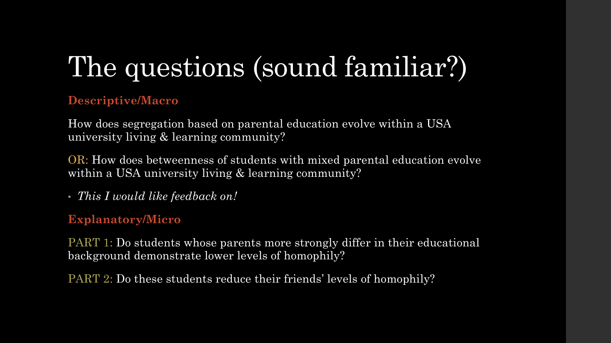
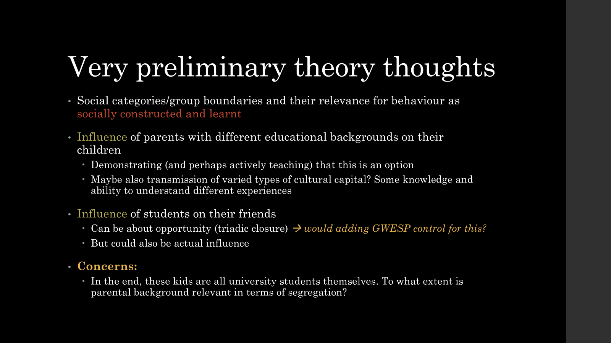
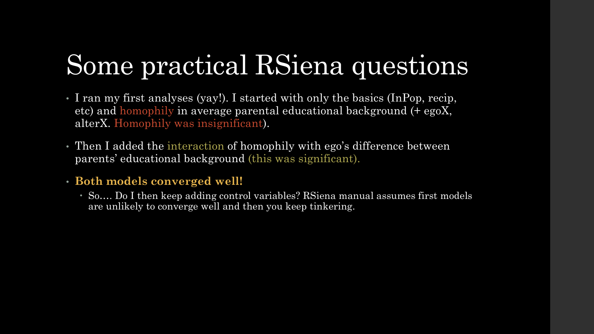

```{r setup, include=FALSE}
knitr::opts_chunk$set(echo = TRUE)
```

# Progress Update








# How to build a model?

**Step 1: convergence as prerequisite for a good model**

In next model, use parameter values from previous models(!!!)

Parameter of stat 1 affects parameter of stat 2 (think recip + degree). Fase 3: all parameters are estimated.

Slightly change one parameter, see what happens to the others. Generates variance/covariance matrix, specifies SEs.

-   More iterations in fase 3 –\> more specific SEs

**Step 2: how similar is our simulated network to our observed network? –\> GOF**

Based on characteristics that were not part of model

Macro-like characteristics!

-   Based on descriptive statistics that stood out

Don't make it too complex. Use standard available characteristics

Just say it fits. Nobody cares

**Step 3: to what extent does this explain macro situation? –\> simulation with parameter on 0**

# Side notes

**Time heterogeneity** can arise because once network is set, homophily becomes less relevant (relative to structural effects)

If it's not there on macro, how could it still be there on micro?

-   Moran on distance 1 or decay, row-standardised or not –\> check if it remains insignificant

**Use absDiffX instead of simX?**

SimX

-   SimX does something like score of i minus score of j

    -   Results in preference for people with lower scores vs people with higher scores, even if absolute difference is the same

        -   Never mind! It does take absolute values

-   It divides by observed range (not theoretical range)

    -   Perfect similarity –\> 1

    -   Largest observed dissimilarity –\> 0

-   Subtracts average similarity score of network

    -   Not updated with every miniscore?

-   Interpretation: I want friends with a similarity score closer to me relative to the similarity score of the entire class

-   Advantage: if you want to compare multiple variables, it doesn't matter

absDiffX

-   xij multiplied by absolute (vi minus vj)

-   Advantage: I understand what I'm doing with this

**Scaling**

Can help with convergence issues

**Moran's I**

See RSiena tutorial for Jochem's use of this as goodness of fit
